# ⚙️ AskMyNotes: Backend Architecture & Technical Reference

Welcome to the technical backend documentation for **AskMyNotes**. This guide explains how the backend services operate, the complete AI & RAG (Retrieval-Augmented Generation) pipeline, the specific machine learning models and token configurations used, and how to interact with the APIs.

---

## 📌 Table of Contents

1. [Architecture Overview (Two-Tier Design)](#1-architecture-overview-two-tier-design)
2. [Languages & Technology Stack](#2-languages--technology-stack)
3. [AI Models & Token Specifications](#3-ai-models--token-specifications)
4. [How the RAG Architecture Works (Step-by-Step)](#4-how-the-rag-architecture-works-step-by-step)
5. [The Dual-Gate Anti-Hallucination System](#5-the-dual-gate-anti-hallucination-system)
6. [Specialized AI Engines](#6-specialized-ai-engines)
7. [API Endpoint Reference](#7-api-endpoint-reference)
8. [Data Storage & Persistence Layout](#8-data-storage--persistence-layout)
9. [Local Setup & Developer Guide](#9-local-setup--developer-guide)
10. [Known Gotchas & Architecture Notes](#10-known-gotchas--architecture-notes)

---

## 1. Architecture Overview (Two-Tier Design)

AskMyNotes separates web handling from heavy AI computations by running two decoupled microservices:

```
┌─────────────────────────────────────────┐               ┌─────────────────────────────────────────┐
│        Node.js Gateway / Web App        │               │         Python FastAPI AI Engine        │
│               (Port 3000)               │ ────────────> │               (Port 8000)               │
│                                         │   HTTP REST   │                                         │
│  • Express HTTP Controller              │               │  • Document Extractors & OCR            │
│  • User Signup, Login, Password Hashes  │               │  • SentenceSplitter Token Chunking      │
│  • Subject Enforcer (Max 3 per student) │               │  • Local Sentence-Transformers          │
│  • Multer File Storage on Disk          │               │  • FAISS Vector Search per Subject      │
│  • Sliding-Window Chat History          │               │  • Hybrid Search (70% Vector + 30% Word)│
│  • Hosts Frontend SPA                   │               │  • Groq LPU Inference (LLM & Vision)    │
└─────────────────────────────────────────┘               └─────────────────────────────────────────┘
```

### Why a Two-Tier Architecture?
- **Node.js (Port 3000)** is event-driven and fast at handling client connections, serving web pages, managing token authentication, and streaming file uploads.
- **Python (Port 8000)** is the primary ecosystem for machine learning, vector indexes (`faiss-cpu`), document parsers (`PyMuPDF`, `python-docx`, `python-pptx`), and AI orchestration (`llama-index-core`).

---

## 2. Languages & Technology Stack

| Layer | Language / Runtime | Primary Libraries / Frameworks | Responsibility |
| :--- | :--- | :--- | :--- |
| **API Gateway** | **Node.js** (v18+) | `express`, `multer`, `axios`, `crypto`, `cors` | Client routing, sessions, file saving, proxying to Python |
| **AI / RAG Service**| **Python** (v3.10 / v3.11) | `fastapi`, `uvicorn`, `llama-index-core`, `faiss-cpu`, `sentence-transformers`, `PyMuPDF`, `textstat`, `groq` | Document parsing, text chunking, vector embeddings, RAG retrieval, LLM prompting |
| **Frontend UI** | **Vanilla JS (ES6+)** | Native Web APIs (Web Speech API, Fetch, LocalStorage), Semantic HTML5, CSS3 | Single-page application, speech-to-text, audio playback, UI state |

---

## 3. AI Models & Token Specifications

AskMyNotes uses a combination of local vector models, cloud reasoning LLMs, and vision models:

```
┌────────────────────────────────────────────────────────────────────────────────────────┐
│                                 AI MODELS SUMMARY                                      │
├──────────────────────┬────────────────────────┬─────────────────────┬──────────────────┤
│ Task                 │ Model Name             │ Engine / Provider   │ Specs / Settings │
├──────────────────────┼────────────────────────┼─────────────────────┼──────────────────┤
│ Vector Embeddings    │ all-MiniLM-L6-v2       │ SentenceTransformers│ 384 dimensions   │
│                      │                        │ (Runs locally)      │ CPU-friendly     │
├──────────────────────┼────────────────────────┼─────────────────────┼──────────────────┤
│ Grounded Q&A / RAG   │ openai/gpt-oss-120b    │ Groq LPU Cloud API  │ Temp: 0.1        │
│ Quizzes & Flashcards │                        │                     │ Strict JSON mode │
├──────────────────────┼────────────────────────┼─────────────────────┼──────────────────┤
│ Handwritten Notes    │ qwen/qwen3.8-27b       │ Groq Vision API     │ Multi-modal      │
│ Vision Transcription │                        │                     │ Base64 image in  │
├──────────────────────┼────────────────────────┼─────────────────────┼──────────────────┤
│ Image / PPTX OCR     │ Tesseract Engine       │ pytesseract (Local) │ Optical OCR      │
└──────────────────────┴────────────────────────┴─────────────────────┴──────────────────┘
```

### Detailed Token & Context Limits (`config.py`)

- **Chunk Size (`CHUNK_SIZE`)**: **`512 tokens`**  
  Each document page is divided into blocks of approximately 512 tokens. This size is optimal: large enough to capture complete conceptual explanations, yet small enough to keep vector searches precise.
- **Chunk Overlap (`CHUNK_OVERLAP`)**: **`50 tokens`**  
  Consecutive chunks overlap by 50 tokens. This prevents important definitions or formulas from being abruptly split across chunk boundaries.
- **Top-K Retrieved Chunks (`TOP_K`)**: **`5 chunks`**  
  During standard Q&A, the top 5 most relevant chunks are retrieved ($5 \times 512 \approx 2,560$ tokens of note context sent to the LLM).
- **Study Mode Chunks (`TOP_K_STUDY`)**: **`15 chunks`**  
  When generating quizzes and flashcards, up to 15 chunks ($15 \times 512 \approx 7,680$ tokens) are sampled evenly across notes to ensure broad topic coverage.
- **Conversational Memory Window**: **`Last 4 turns`**  
  The last 4 question-answer exchanges are included in the prompt context to allow follow-up questions while preventing prompt bloat. (The server tracks up to 8 turns in RAM).
- **LLM Temperature (`LLM_TEMPERATURE`)**: **`0.1`**  
  A very low temperature ensures highly deterministic, factual answers that stick strictly to provided notes rather than being creative.

---

## 4. How the RAG Architecture Works (Step-by-Step)

RAG (**Retrieval-Augmented Generation**) ensures the AI only speaks from your course notes. The pipeline consists of two phases: **Ingestion** (offline) and **Retrieval** (online).

```mermaid
flowchart TD
    subgraph Ingestion ["Phase 1: Document Ingestion Pipeline"]
        Upload[File Upload: PDF, Word, PPTX, Images] --> Parser[Format Parsers: PyMuPDF, docx, pptx, OCR]
        Parser --> Chunker["SentenceSplitter (Size: 512, Overlap: 50)"]
        Chunker --> Embedder["SentenceTransformer (all-MiniLM-L6-v2)"]
        Embedder --> L2Norm["L2 Normalization (faiss.normalize_L2)"]
        L2Norm --> IndexFile[("index.faiss (FAISS IndexFlatIP)")]
        Chunker --> MetaFile[("chunks_meta.json (Text + Page Numbers)")]
    end

    subgraph QueryFlow ["Phase 2: Query & Retrieval Pipeline"]
        UserQ[User Question] --> QEmbed["Embed Question (384-dim vector)"]
        QEmbed --> FAISSSearch["FAISS Top-K Search (Cosine Similarity)"]
        UserQ --> LexicalSearch["Keyword Match (Stopword-filtered token overlap)"]
        FAISSSearch & LexicalSearch --> HybridCalc["Hybrid Score = 0.70*Semantic + 0.30*Lexical"]
        HybridCalc --> Gate1{"Top Score >= 0.45?"}
        Gate1 -->|No| Reject1["Gate 1 Refusal: Immediate Refusal\n(No LLM call made)"]
        Gate1 -->|Yes| PromptGen["Build Prompt with Top Chunks + History"]
        PromptGen --> GroqLLM["Call Groq LLM (gpt-oss-120b)"]
        GroqLLM --> Gate2{"LLM finds answer?"}
        Gate2 -->|No| Reject2["Gate 2 Refusal: AI reports answer not in evidence\n(Shows closest snippets)"]
        Gate2 -->|Yes| AnswerReady["Deliver Grounded Answer + Exact Page Citations"]
    end
```



### Phase 1: Ingestion Pipeline ([ingestion.py](file:///c:/Github/AskMyNotes-Team_Rocket/python-service/ingestion.py))
1. **Document Parsing**:
   - **PDFs**: Parsed page-by-page using `fitz` (`PyMuPDF`). Each page maintains its original `1-indexed` page number.
   - **Word (`.docx`)**: Paragraphs and table structures extracted using `python-docx`.
   - **PowerPoint (`.pptx`)**: Slide text, grouped shapes, and slide images extracted with `python-pptx` and Tesseract OCR.
   - **Images (`.png`, `.jpg`, `.webp`)**: OCR transcribed using `pytesseract`.
   - **ZIP Archives**: Automatically unpacked and processed recursively.
2. **Grammatical Chunking**:
   - Uses LlamaIndex's `SentenceSplitter`. Rather than cutting text at arbitrary character limits, it respects sentence and paragraph boundaries.
3. **Embedding Vectorization**:
   - Chunks are vectorized into 384-dimensional dense vectors using `all-MiniLM-L6-v2`.
   - Vectors are L2-normalized so that inner products correspond directly to cosine similarity.
   - Stored in per-subject isolated FAISS indexes (`IndexFlatIP`).

### Phase 2: Hybrid Retrieval ([retriever.py](file:///c:/Github/AskMyNotes-Team_Rocket/python-service/retriever.py))
Pure vector search can sometimes miss exact technical names, acronyms, or numbers. Pure keyword search misses conceptual synonyms. AskMyNotes combines both:

1. **Semantic Similarity ($S_{\text{semantic}}$)**:  
   Cosine similarity between query vector and note chunk vectors (0.0 to 1.0).
2. **Lexical Keyword Overlap ($S_{\text{lexical}}$)**:  
   Measures keyword overlap after filtering out 32 common English stopwords:
   $$S_{\text{lexical}} = \frac{|\text{Tokens}_{\text{query}} \cap \text{Tokens}_{\text{chunk}}|}{|\text{Tokens}_{\text{query}}|}$$
3. **Composite Hybrid Score**:
   $$\mathbf{Score_{\text{hybrid}} = 0.70 \times S_{\text{semantic}} + 0.30 \times S_{\text{lexical}}}$$
   Chunks are sorted by this hybrid score, and the top 5 are passed forward as verified evidence.

---

## 5. The Dual-Gate Anti-Hallucination System

To ensure that AskMyNotes never hallucinates, it employs a **two-layer safety verification** mechanism:

| Gate | Stage | Condition | Action Taken |
| :--- | :--- | :--- | :--- |
| **Gate 1** | **Pre-LLM** (Search level) | Top chunk hybrid score $< 0.45$ (`GATE_1_THRESHOLD`) | **Halt immediately**. No LLM API call is made. Saves tokens and returns: *"Not found in your notes for [Subject]"*. |
| **Gate 2** | **Post-LLM** (Reasoning level) | LLM evaluates evidence and returns `"answer_found": false` | The AI honestly refuses to answer. The system returns the refusal while displaying the **closest 3 citations and text snippets** for user transparency. |

### The LLM Grounding Prompt ([query_engine.py](file:///c:/Github/AskMyNotes-Team_Rocket/python-service/query_engine.py))
The LLM is strictly constrained using this system prompt:
```text
You are a study assistant. Answer ONLY using the provided evidence from the student's {subject_name} notes.

RULES:
1. ONLY use information from the evidence below. Do NOT add external knowledge.
2. If the evidence does NOT contain enough information to answer, set "answer_found" to false.
3. Include citations referencing the source filename and page number.
4. Estimate what percentage of your answer is derived directly from the evidence (grounding_percentage, 0-100).

EVIDENCE:
[Evidence 1] (Source: Chapter1.pdf, Page 4, Chunk #2, Score: 0.890) ...
[Evidence 2] (Source: Chapter1.pdf, Page 5, Chunk #3, Score: 0.742) ...

QUESTION: {user_query}
```

---

## 6. Specialized AI Engines

### 1. Study & Quiz Engine ([study_engine.py](file:///c:/Github/AskMyNotes-Team_Rocket/python-service/study_engine.py))
- **Broad Chunk Sampling**: Uses `retrieve_broad()` to evenly sample up to 15 chunks across the subject or from a single selected document.
- **Generation**: Calls Groq (`openai/gpt-oss-120b`) to produce:
  - **5 Multiple-Choice Questions (MCQs)** with 4 options, the correct answer key, and an explanation.
  - **3 Short-Answer Questions** with reference answers.
  - **5 3D Flashcards** with concise front concepts and back explanations.
  - Every single item includes the source filename and page number it was generated from.

### 2. Concept Simplification Engine ([simplify_engine.py](file:///c:/Github/AskMyNotes-Team_Rocket/python-service/simplify_engine.py))
- Calculates the baseline reading level of an answer using the **Flesch-Kincaid Grade Level formula** (`textstat.flesch_kincaid_grade`).
- Prompts the LLM to rewrite the explanation in simple language suitable for a middle-school student (shorter sentences, plain vocabulary) without altering facts or citations.
- Recalculates the grade level to mathematically verify improvement (`simplified_grade < original_grade`).

### 3. Handwritten Notes Vision Engine ([handwriting_engine.py](file:///c:/Github/AskMyNotes-Team_Rocket/python-service/handwriting_engine.py))
- Encodes notebook photos into base64.
- Calls Groq Vision (`qwen/qwen3.8-27b`) with prompt instructions to preserve lists, headings, and mark illegible words as `[unclear]`.
- Returns text for student review in the UI before it is chunked and added to the subject's FAISS index.

---

## 7. API Endpoint Reference

### Node.js Gateway (Port 3000)

| Method | Endpoint | Description | Request Body / Parameters |
| :--- | :--- | :--- | :--- |
| `POST` | `/api/auth/signup` | Create student account | JSON: `{ name, email, password }` |
| `POST` | `/api/auth/login` | Login & receive bearer token | JSON: `{ email, password }` |
| `GET` | `/api/auth/me` | Fetch active user profile | Header: `Authorization: Bearer <token>` |
| `POST` | `/api/auth/logout` | Terminate session | Header: `Authorization: Bearer <token>` |
| `GET` | `/api/subjects` | List student's subjects & file counts | Header: `Authorization: Bearer <token>` |
| `POST` | `/api/subjects/create` | Create subject (max 3 per student) | JSON: `{ name }` |
| `DELETE`| `/api/subjects/:id` | Delete subject & wipe vector index | Path param: `id` |
| `POST` | `/api/upload/:subjectId` | Upload & ingest a note file | Form-data: `file` |
| `DELETE`| `/api/files/:subjectId/:filename` | Delete a single file from vector index | Path params: `subjectId`, `filename` |
| `POST` | `/api/query` | Ask note-grounded question | JSON: `{ subject_id, query }` |
| `POST` | `/api/ai-answer` | "Ask General AI" fallback | JSON: `{ query }` |
| `POST` | `/api/study/:subjectId` | Generate 5 MCQs, 3 short Qs, 5 flashcards | JSON: `{ selected_filename? }` |
| `POST` | `/api/simplify` | Simplify reading grade level | JSON: `{ original_answer, evidence_snippets, ... }` |
| `GET` | `/api/conversations/:subjectId`| Retrieve chat history for subject | Header: `Authorization: Bearer <token>` |

---

### Python AI Service (Port 8000)

| Method | Endpoint | Description | Request Body / Parameters |
| :--- | :--- | :--- | :--- |
| `GET` | `/py/health` | Health check probe | None (returns `{"status": "ok"}`) |
| `POST` | `/py/ingest` | Chunk and embed file into FAISS | Form-data: `file`, `subject_id` |
| `POST` | `/py/query` | Run hybrid search & dual-gate RAG | JSON: `{ subject_id, subject_name, query, conversation_history? }` |
| `POST` | `/py/ai-answer` | Unbounded Groq answer | JSON: `{ query }` |
| `POST` | `/py/study` | Broad sample & quiz generation | JSON: `{ subject_id, subject_name, selected_filename? }` |
| `POST` | `/py/simplify` | Re-phrase answer with textstat | JSON: `{ original_answer, evidence_snippets, ... }` |
| `POST` | `/py/handwriting` | Transcribe image via Groq Vision | Form-data: `file` |
| `POST` | `/py/handwriting/add` | Save transcribed text as a note chunk | JSON: `{ subject_id, filename, text }` |
| `DELETE`| `/py/subject/{subject_id}` | Wipe directory & FAISS index | Path param: `subject_id` |
| `DELETE`| `/py/file/{subject_id}/{filename}`| Rebuild FAISS without specific file | Path params: `subject_id`, `filename` |

---

## 8. Data Storage & Persistence Layout

AskMyNotes persists data using flat JSON documents and binary FAISS indexes:

```text
AskMyNotes-Team_Rocket/
├── node-api/data/
│   ├── users.json          # Student accounts with scrypt password hashes and salts
│   ├── subjects.json       # Subject records linked to userId
│   ├── files.json          # Metadata of uploaded files (size, chunk count, timestamps)
│   ├── conversations.json  # Long-term persistent chat history
│   └── users/              # Uploaded physical files:
│       └── <userId>/subjects/<subjectId>/files/<filename>
│
└── python-service/data/
    └── <subject_id>/       # Dedicated folder per subject workspace
        ├── index.faiss     # Serialized binary FAISS IndexFlatIP (384-dimensional vectors)
        └── chunks_meta.json# Extracted text chunks, page numbers, and chunk IDs
```

---

## 9. Local Setup & Developer Guide

### Prerequisites
- **Python 3.10 or 3.11**
- **Node.js 18+**
- **Tesseract OCR** (For image/PPTX OCR)
  - Windows: Install to `C:\Program Files\Tesseract-OCR\tesseract.exe`
- **Groq API Key**: Obtainable from [console.groq.com/keys](https://console.groq.com/keys)

---

### Step 1: Start the Python Service

```bash
cd python-service

# Setup virtual environment
python -m venv venv
.\venv\Scripts\Activate.ps1    # On Linux/macOS: source venv/bin/activate

# Install dependencies
pip install -r requirements.txt

# Create .env file with your key:
# GROQ_API_KEY=gsk_...
# GROQ_VISION_MODEL=qwen/qwen3.8-27b

# Launch service
python -m uvicorn main:app --reload --port 8000
```

Verify service status: `http://localhost:8000/py/health`

---

### Step 2: Start the Node.js API Gateway

Open a second terminal window:

```bash
cd node-api

# Install dependencies
npm install

# Start Express server
node server.js
```

Verify gateway: Open `http://localhost:3000` in your web browser.

---

## 10. Known Gotchas & Architecture Notes

1. **In-Memory Sessions**:
   - Active tokens are kept in an in-memory `Map` in `node-api/server.js`. Restarting the Node process will require students to re-login. (Accounts, subjects, and files are permanently saved).
2. **Subject Limit (Max 3)**:
   - Node enforces a limit of 3 active subjects per user account to keep vector indexes focused and eliminate cross-subject interference.
3. **Tesseract Executable Path**:
   - The Tesseract binary path is configured in `python-service/ingestion.py#L17`. If running on non-Windows platforms or custom installation paths, adjust this variable accordingly.
4. **Subject Index Rebuilds on Deletion**:
   - When deleting an individual file from a subject, Python removes its chunks from `chunks_meta.json` and completely re-encodes the remaining chunks into a fresh `IndexFlatIP` to guarantee zero residual vectors.
